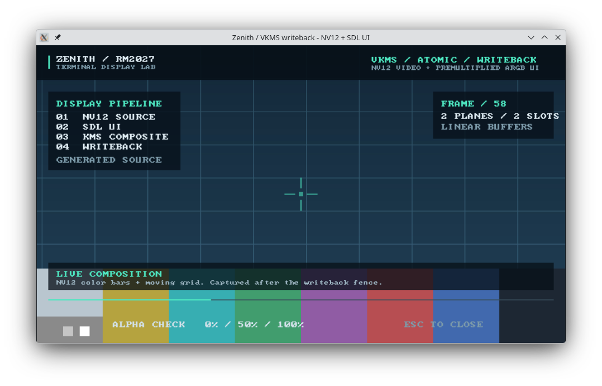
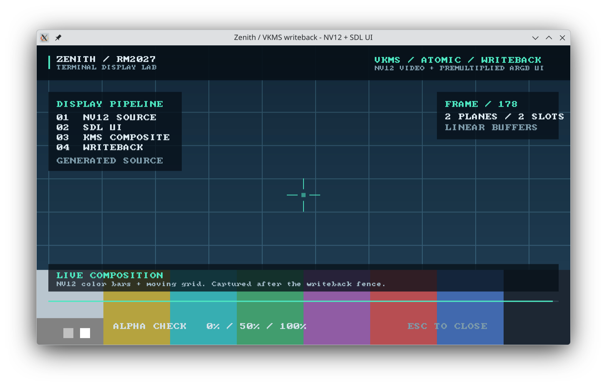

# 定位 NV12 双 plane 预览的耗时

保持真实 NV12 视频 plane + SDL ARGB UI plane，由 VKMS 合成后 writeback。
当前单一累计补丁在 1280×720、60 Hz 模式下，1200 帧实际窗口预览平均 **59.15 FPS**，
帧时中位数 **16.656 ms**，接近每个刷新周期一帧。整幅固定帧与原模块逐字节一致。
仍有少量长帧，不能把本次平均帧率当成每帧不超过 16.67 ms 的实时保证。

补丁源码、构建与恢复见 [VKMS 补丁说明](../patches/linux-vkms/README.md)。
仓库仅维护一个 patch，直接应用到原始基线；下方旧结果用于说明定位过程。

## 复现分段计时

先按 [预览指南](VKMS_PREVIEW.md) 取得 VKMS 控制权，然后在仓库根目录执行：

```bash
mkdir -p build/perf
./build/native/bin/ZenithTerminal --drm-demo --take-over --no-preview \
  --uncapped --frames 110 --warmup 10 --profile build/perf/nv12-wb.csv
python3 tools/vkms/summarize-profile.py build/perf/nv12-wb.csv
```

默认仍为 NV12、启用 writeback、完整 atomic 状态、约 30 FPS 应用限速。
`--uncapped` 仅移除应用 sleep，不移除 VKMS 的刷新节奏。
`--frames 110 --warmup 10` 总共提交 110 帧，CSV 将前 10 帧标为预热，汇总余下 100 帧。
CSV 在正常退出时刷新；异常中止的文件可能不完整。

控制变量每次只改一项，仍使用两个真实 DRM plane：

- `--video-format xrgb`：RGB 视频源，检查跳过 YUV 转换后的差异。图案不完全相同，
  几何、UI、writeback 分辨率和灰度验证区域相同；不是 NV12 功能验收。
- `--no-writeback --no-preview`：只提交扫描状态，不能截图或验证合成像素。
  VKMS 在这个配置下不必每帧执行软件合成，所以高 FPS 不代表合成吞吐。
- `--state delta`：首次完整配置，后续仅更新 plane FB 和 writeback FB/fence。
  默认 `full` 保持原先行为；测试未显示 delta 能解决主要瓶颈。
- 去掉 `--no-preview`：真实桌面窗口预览，单独计入 `preview_ms`。

CSV 列含义：

- `video_ms` / `ui_ms`：写测试视频 / SDL 离屏绘制。
- `request_ms`：准备 atomic 属性；`commit_ms`：blocking atomic ioctl。
- `writeback_ms`：ioctl 返回后的 fence 等待和状态检查。未启用 writeback 时仅有记时开销。
- `verify_ms`：逐帧三个 alpha 样本；`capture_ms`：可选 BMP 保存。
- `preview_ms`：窗口上传/呈现；`work_ms`：从填图到预览完成。
- `pacing_ms`：末尾日志和限速等待；`total_ms`：完整循环时间。

汇总 FPS = 1000 / 平均 `total_ms`，不把每帧 FPS 算术平均。
`commit_ms` 和 `writeback_ms` 是用户态观测区间，不是两项相互独立的内核计算成本。

## 原模块对照：2026-11-12

环境：CachyOS `7.3.3-1-cachyos`，1280×720，双缓冲，关闭窗口和应用限速，
每组 110 帧、排除前 10 帧。下列值为 100 帧平均，单位 ms。

| 配置 | commit | writeback 等待 | 整帧 | FPS |
|---|---:|---:|---:|---:|
| NV12 + writeback / full | 110.325 | 118.898 | 232.145 | 4.31 |
| RGB + writeback / full | 2.886 | 12.302 | 17.149 | 58.31 |
| NV12 / 无 writeback | 13.856 | 接近 0 | 16.655 | 60.04 |
| NV12 + writeback / delta | 108.520 | 117.519 | 228.986 | 4.37 |

NV12 基线的填图约 1.604 ms、UI 约 1.306 ms、准备 atomic 属性约 0.008 ms。
各 writeback 对照均通过每帧 alpha 检查。原始 CSV/log 位于 `build/perf/`：
`baseline`、`rgb-wb-full`、`nv12-no-wb-full`、`nv12-wb-delta`。

源码解释：`vkms_atomic_commit_tail()` 会 `flush_work()` 等待旧状态的 composer
工作。因此软件合成慢也会体现为 blocking atomic ioctl 慢，不能仅根据这两列
把原因归为“atomic 属性太多”或“内存写回带宽”。

检查当前模块反汇编和定点算术源码后发现：YUV→RGB 每像素九次定点乘法中的
有效位查找含逐位循环。第一版补丁用内核 `fls64()` 替换查找，保留颜色计算语义。
实测补丁显著降低 commit 与 writeback 等待时间，验证这段计算是主要瓶颈之一。

## 第一轮位扫描优化对照：2026-11-12

运行中模块 srcversion 为 `BF1CB2E2F6FFF328AE4EE29`，与候选模块一致。
使用与原模块相同的分辨率、双 plane、帧数、预热和限速设置。

| 配置 | commit / ms | writeback 等待 / ms | 整帧 / ms | FPS |
|---|---:|---:|---:|---:|
| NV12 + writeback / full | 18.936 | 26.862 | 48.505 | 20.62 |
| RGB + writeback / full | 2.581 | 12.227 | 16.820 | 59.45 |
| NV12 / 无 writeback | 13.782 | 接近 0 | 16.650 | 60.06 |
| NV12 + writeback / delta | 19.280 | 27.266 | 49.469 | 20.21 |

NV12 整帧从 232.145 降至 48.505 ms；RGB 与无 writeback 对照仍接近 60 FPS。
减少 atomic 属性没有改善主要瓶颈，所以保留默认 full 提交，不把 delta 设为默认优化。
该轮 NV12 合成尚未达到 30/60 FPS，随后在同一个 patch 中加入精确查表和下述优化。

### 完整画面和实际预览

- 真实 framebuffer atomic TEST_ONLY 通过。
- 同一第 39 帧的 `before-frame39.bmp` 与 `after-frame39.bmp` 使用 `cmp` 比较完全一致：
  1280×720，共 921,600 个 RGB 像素，连同 BMP 文件内容全部一致。
- 600 帧实际窗口运行完成，每帧 alpha=0/128/255 校验通过。
  去掉 10 帧预热后 590 帧平均 **20.50 FPS**；窗口上传/呈现平均 **2.054 ms**。
  全部 600 帧运行 29.40 秒，含启动阶段平均 20.41 FPS。
- 已查看真实窗口截图，透明面板、文字、网格、色条和帧号显示正常。
- 程序退出后已恢复系统原模块 `6A20A3C0EC14F8CECBF18F8`，桌面重新持有 VKMS。
  HDMI-A-1、DP-1、Virtual-1 的模式、位置、缩放、旋转、优先级与本轮交接前一致。
  客户端在桌面持有 master 时正确拒绝运行。



### 构建与证据

- 数学等价性：位扫描边界/100 万个随机值、3,538,944 项颜色乘法、60 万组完整像素，
  UndefinedBehaviorSanitizer 无错误。
- 本机应用 CTest 5 项通过；RK3566 交叉编译通过，AArch64 ELF/动态加载器及
  27 项版本要求检查通过；QEMU 的 smoke 和 DRM/UI 单元测试通过。
- 当前运行平台验证为 x86_64 CachyOS；Intel/ARM64 的源码可移植性依据是 Linux
  `fls64()` 接口，本轮没有在这些机器上实测 VKMS 模块。

[分段均值与帧数记录](evidence/vkms-performance-2026-11-12.json)。原始证据在 `build/perf/`：
`fast-*.csv/log`、`fast-test-only.log`、`pixel-compare.log`、`before-frame39.bmp`、
`after-frame39.bmp`、`math-check.log`、`module-build.log`、`native-tests.log`、
`cross-build.log`、`cross-elf.log`、`cross-qemu.log`、`restored-master-guard.log`。
显示交接前后记录为 `build/native/vkms-session/perf-before.json` 与 `perf-after.json`。

第一轮构建产物 `build/perf/vkms-fast/vkms.ko` 保留作实验记录，不作为当前推荐模块。

## 当前累计补丁：接近 60 Hz 刷新上限

本轮在同一个 patch 内依次增加精确 NV12 查表、UV 复用、XRGB8888 按行写回和
alpha 端点快速路径。没有改变分辨率、测试图、SDL UI、两 plane、writeback 或同步语义。

中间实验揭示了后续成本：普通查表约 31.12 FPS；复用 UV 并利用矩阵零项后约
39.68 FPS；按行写回后无窗口 59.89 FPS、窗口 58.00 FPS。反汇编确认旧写回循环
每像素经过 `__x86_indirect_thunk_r11`，所以将格式分派移到行级，保留安全机制。
最后增加数学等价的 alpha 端点路径，提升透明 UI 的处理余量。
这些是不同候选的诊断结果，最终验收使用下面同一份模块。

### 最终候选实测

模块：`build/perf/vkms-60fps/vkms.ko`；加载时核对 srcversion
`DE805DCED822DF126BDD22D`。未更改应用二进制、内核刷新率、调度优先级或 CPU 绑定。

| 配置 | 测量帧数（去预热） | 平均 FPS | 平均整帧 / ms | 中位数 / ms | p95 / ms |
|---|---:|---:|---:|---:|---:|
| NV12 双 plane + writeback，无窗口 | 300 | 58.87 | 16.985 | 16.665 | 17.902 |
| NV12 双 plane + writeback，实际窗口 | 1190 | 59.15 | 16.905 | 16.656 | 18.042 |

实际窗口总共运行 1200 帧、20.31 秒，全部通过逐帧 alpha 样本校验。
去掉前 10 帧预热后的分段平均：填图 1.722 ms、UI 1.372 ms、准备请求 0.007 ms、
commit 5.806 ms、writeback 等待 7.144 ms、窗口呈现 0.847 ms。
1190 个测量帧中 21 帧超过 25 ms，最长约 36.73 ms；同一时段填图、UI 和内核等待
都有波动。平均吞吐已进入约 60 FPS 范围，仍保留桌面软件测试环境的偶发抖动。

### 正确性、恢复和使用

- 默认真实缓冲 TEST_ONLY 成功；NV12 + ARGB + XR24 全链路通过。
- 第 39 帧全部 921,600 个 RGB 像素以及 BMP 文件内容，与最初系统原模块完全一致。
- 已查看当前模块的真实窗口截图，文字、透明叠层、网格、色条显示正常。
- 精确查表穷举六种矩阵全部 100,663,296 个 8 位 YUV 组合，输出相同；
  原有 16 位数学测试、NV12 方向/裁剪/步长、按行写回边界及 alpha 混合测试通过。
- 本轮仅更新内核补丁、独立验证工具和文档，应用源码/二进制未变；前一轮本机
  CTest、RK3566 交叉编译、ELF 检查和 QEMU 用户态验证仍适用。
- 结束后已恢复系统原模块 `6A20A3C0EC14F8CECBF18F8`，关闭管理员会话；
  HDMI-A-1、DP-1、Virtual-1 的模式/位置/缩放/旋转/优先级均恢复，桌面重新持有 master。



临时加载当前模块并取得 VKMS 控制权后，用以下命令调试 UI：

```bash
./build/native/bin/ZenithTerminal --drm-demo --take-over --uncapped --frames 0
```

**必须带 `--uncapped` 才能解除默认约 30 FPS 的应用限速。** Escape 或关闭窗口退出。
内核补丁不会改变应用的默认限速设置，也不自动随重启加载。

当前证据：`build/perf/60fps-*.csv/log/bmp`、`60fps-module-build.log`、
`60fps-blend-check.log`，以及最终候选中未再修改的查表/reader/写回实现对应的
`lut-row-check.log`。显示布局为 `build/native/vkms-session/lut-before.json` 和 `lut-after.json`。
[分段均值及长帧统计](evidence/vkms-performance-2026-11-12.json) 同时保存中间候选与最终数据。

本轮曾尝试独立 ftrace instance 做内核细分计时，但该实例的函数过滤/深度配置被拒绝；
已撤销并删除实例，相关试跑不计入性能结论。最终判断依据为应用分段计时、模块反汇编
和真实输出对照。

## 与板端的关系

补丁仅用于 Linux 桌面的 VKMS 软件测试环境。RK3566 正常路径是 MPP 生成 NV12
DMA-BUF，再由 VOP2 做颜色转换和 plane 混合；不需要这份 CPU 转换补丁。
正式板端普通显示不要求 writeback。本示例可用 `--no-writeback --no-preview`
测试仅扫描输出，但板端 plane 格式、分配器和 import 兼容性仍要等实机验证。

参考：[VKMS](https://docs.kernel.org/gpu/vkms.html)、
[本次基线源码](https://github.com/gregkh/linux/tree/v7.3.3/drivers/gpu/drm/vkms)。
