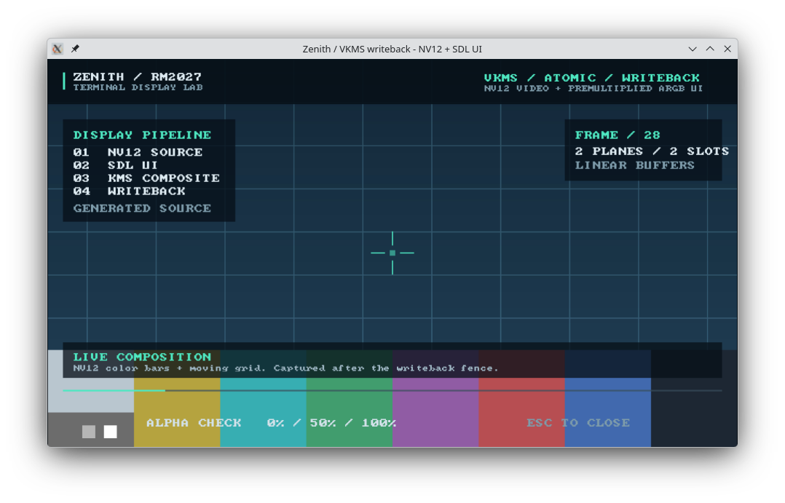

# 本机运行双 plane 与 writeback 预览

同一个 `ZenithTerminal` 现在支持 `--drm-demo`：NV12 测试图和 SDL 透明 UI
分别提交到两个 DRM plane，VKMS 在内核中合成，writeback 完成后显示到桌面窗口。
不需要 BUAA、网络、实际解码器或目标板。



## 1. 构建

在仓库根目录执行：

```bash
cmake --preset native -DZT_ENABLE_DRM=ON -DZT_ENABLE_PREVIEW=ON
cmake --build --preset native
ctest --preset native
```

本机需要 libdrm、Wayland/X11、xkbcommon、EGL/OpenGL 开发文件，以及可用的桌面会话。
SDL 仅为 preview 开启 Wayland/X11 和 OpenGL；没有开启 SDL KMSDRM 或 Vulkan。
默认由 SDL 选择窗口后端和 renderer，启动日志打印实际选择；
`SDL_VIDEO_DRIVER=x11` / `SDL_RENDER_DRIVER=software` 可用于对照。
`zenith_ui` 仍只使用软件 renderer 画到显示模块提供的内存，不创建窗口。

正式应用 CMake target 为 `zenith_terminal`；输出仍叫 `ZenithTerminal`，
原来的 `--self-check`、默认 smoke 行为和 `ZenithTerminal` 构建目标继续可用。
两个新功能选项默认 OFF，仅使用原 smoke 不需要 libdrm/X11。

## 2. 将 VKMS 从桌面暂时释放

先运行 `zenith_drm_probe --driver vkms` 确认卡号。此机当前为 `/dev/dri/card0`，
对应 sysfs 路径 `/sys/devices/faux/vkms/drm/card0`。卡号可能随启动顺序改变；
可以用 `readlink -f /sys/class/drm/cardN` 查路径，不要对 AMD 真实显卡执行下面的操作。

本机是 KDE Wayland。KWin 即使关闭 Virtual-1 也仍持有 DRM master。
本轮通过用户执行一次合成的 udev remove 事件，让 KWin/logind 释放 VKMS，
保留内核虚拟设备和原有用户访问权限。这是当前桌面会话的临时交接，不是卸载模块，
也没有安装永久 udev 规则。其他桌面环境需要按其设备管理方式交接。

在终端执行，**释放前先保留下面的恢复命令**：

```bash
kscreen-doctor -j > /tmp/zenith-displays-before.json
kscreen-doctor output.Virtual-1.disable
sudo udevadm trigger --action=remove /sys/devices/faux/vkms/drm/card0
```

客户端以普通用户运行，通过 `drmIsMaster()` 确认独占控制权。仍被桌面占用时
明确报错退出，不尝试夺取控制权、不自动提权、不终止桌面进程。
`--take-over` 只允许替换已独占设备上遗留的 ACTIVE 状态，不能绕过 DRM master。

## 3. TEST_ONLY，再运行预览

```bash
# 分配真实的 NV12、ARGB、XR24 writeback framebuffer，但不提交显示变化。
./build/native/bin/ZenithTerminal --drm-demo --take-over --test-only

# 持续预览；Escape、关闭窗口或 Ctrl+C 结束。
./build/native/bin/ZenithTerminal --drm-demo --take-over --frames 0

# 有限次测试并保存真正的 writeback 图像。
./build/native/bin/ZenithTerminal --drm-demo --take-over \
  --frames 120 --capture /tmp/zenith-writeback.bmp
```

默认自动查找 VKMS；`--device /dev/dri/cardN` 可显式指定设备。默认仍为
1280×720，可用 `--size 1920x1080` 对齐 RM2027 视频规格。宽高必须为偶数、
在 320×240～4096×2160 范围内，且设备提供对应模式。要求线性 NV12 primary、线性 ARGB8888 overlay、XR24 writeback
和对应显示模式。缺少所需组合直接报错，不换成 SDL 合成。

默认运行 300 帧；`--no-preview` 不创建桌面窗口，仍执行真实 KMS 合成、
writeback 和像素校验。`--capture` 在第 31 帧及指定的最后一帧保存 BMP；
文件不存在的目录会导致报错并清理。TEST_ONLY 模式不生成截图。

每次运行都会先执行带真实 FB 的 atomic TEST_ONLY。实际提交使用两个缓冲槽
轮换：只修改未被扫描输出的槽；blocking atomic commit 完成替换，再等待
writeback fence 成功后读取结果、校验和预览。预览只上传这张 XR24 图，不接触
视频/UI 源图。最大节奏设为 30 帧/秒，实际速度由软件 VKMS 和显示链路决定。

### 1080p 的调试入口

加载累计优化补丁并释放 VKMS 后：

```bash
./build/native/bin/ZenithTerminal --drm-demo --size 1920x1080 \
  --pipeline --take-over --uncapped --frames 0
```

`--pipeline` 将一次同步 present 拆为 blocking commit 和 writeback 等待：
commit 返回后，旧扫描槽已释放；应用在这个槽准备下一帧，同时内核读取当前槽。
随后等待当前 fence，再校验和预览。仍只有两个槽、一次在途 writeback；不覆盖扫描中
或正在写回的缓冲，也不丢帧。原同步 `present()` 和默认运行方式保留。
OpenGL 只呈现已经完成的 writeback 图像，视频与 UI 仍由 VKMS 的两个 plane 合成。

可选硬件生命周期回归（会修改指定虚拟卡的 KMS 状态，不纳入普通 CTest）：

```bash
./build/native/app/src/display/drm/zenith_drm_lifecycle_test /dev/dri/card0 --take-over
```

透明 UI 使用预乘 alpha，匹配 KMS 默认混合语义。底部三个验证点的 alpha
分别是 0、128、255；NV12 背景灰度随帧变化，每帧从 writeback 校验三个点的
RGB（容差 3）。它同时验证透明/半透明/不透明混合、图层顺序及输出确实更新，
不能用只显示上一张图蒙混通过。

## 4. 退出与交回桌面

正常结束、Escape/关闭窗口、SIGINT/SIGTERM 或应用异常时，先等待未完成的
writeback，再同步禁用本次使用的 CRTC/plane，最后释放 FB、映射、GEM 和 fd。
TEST_ONLY 不改变初始显示状态。若内核 fence 超时，程序报告并保留资源等待
完成，不提前回收仍在使用的写回缓冲。

最后关闭 DRM fd 后，内核 fbdev 可能重新点亮自己的默认模式；这不代表客户端
仍持有 master。因此下次运行通常仍使用 `--take-over`。本轮测试确认该行为存在。

**先结束客户端，再交回桌面：**

```bash
sudo udevadm trigger --action=add /sys/devices/faux/vkms/drm/card0
kscreen-doctor output.Virtual-1.enable
```

需要恢复位置时按之前保存的布局设置。本机原位置是：

```bash
kscreen-doctor output.Virtual-1.position.2720,0
```

上一轮 600 帧测试的交接已经恢复：Virtual-1、HDMI-A-1、DP-1 的模式、位置、缩放、旋转和
优先级均与测试前一致。原始布局记录在 `build/native/vkms-session/`。

## 5. RK3566 保持同一套显示代码

```bash
cmake --preset rk3566-clang -DZT_ENABLE_DRM=ON -DZT_ENABLE_PREVIEW=OFF
cmake --build --preset rk3566-clang
SDK_HOST=/home/ww/codings/sdks/radxa-rk356x-linux6.1-rkr4/buildroot/output/rockchip_rk3566/host
python3 tools/check-rk-elf.py build/rk3566-clang/bin/ZenithTerminal --sdk-root "$SDK_HOST"
```

板端构建同一份 DRM atomic、缓冲管理、SDL 离屏 UI 和应用代码；不构建桌面
preview，也不链接 X11。示例默认要求 writeback，可通过 `--no-writeback --no-preview` 关闭；
是否适合板上直接运行需等实机能力探测，不将 writeback 作为普通 HDMI
显示的必要条件。本轮完成交叉编译与用户态测试，不代表已经完成 Rockchip 上板合成。

## 实现位置与验收

- `src/display/drm/atomic_display.cpp`：唯一 DRM 状态与资源所有者，线性 dumb FB、
  路由选择、TEST_ONLY、atomic 提交、writeback fence、双缓冲与退出清理。
- `src/ui/ui.cpp`：SDL 离屏 UI，按真实 pitch 写入外部 ARGB 缓冲并预乘 alpha。
- `src/preview/preview.cpp`：纯 writeback 图像窗口；独立 `zenith_preview` 库。
- `src/app/drm_demo.cpp`：NV12 测试源、模块组装、每帧验证、信号与参数处理。
- `tests/ui_tests.cpp`：透明像素/预乘值和 pitch padding；纳入 `zenith_tests`。

2026-11-12 验收：

- 本机真实 framebuffer TEST_ONLY 成功。
- 桌面窗口预览连续运行 **600 帧**，每帧三组 alpha 样本均通过。
- 实际 writeback 图像及实际桌面窗口截图均已查看，UI 文字、透明面板和动态图案正常。
- SIGINT 中断与截图写入失败均能退出；失败后重新打开 VKMS 可取得 master。
- 桌面收回 VKMS 后，客户端正确拒绝运行，不改变桌面显示。
- 本机 CTest 通过；AArch64 交叉构建和 ELF 检查通过，无 RPATH/RUNPATH。
- ARM QEMU 下的原 smoke、DRM/UI 单元测试及 demo 帮助入口通过。
- 1280×720 的短程无窗口测试测得约 **4.49 FPS**；目前可验证布局与合成正确性，
  后续单一累计补丁已将实际窗口提高到约 59.15 FPS（1200 帧运行）；
  见下方性能记录。以上均为桌面软件测试性能，不是板端硬件显示性能。

证据：`build/native/atomic-test-only.log`、`writeback-preview.log`、
`preview-sigint.log`、`preview-failure-cleanup.log`、`preview-owner-denied.log`
（以上均位于 `build/native/`），以及 `build/rk3566-clang/preview-*.log`。
图像存于 `doc/evidence/vkms-writeback-2026-11-12.png` 和
`doc/evidence/vkms-preview-window-2026-11-12.png`。

参考：[KMS atomic/writeback 与混合属性](https://docs.kernel.org/gpu/drm-kms.html)、
[VKMS 配置](https://docs.kernel.org/gpu/vkms.html)、
[KWin DRM 设备事件处理](https://github.com/KDE/kwin/blob/master/src/backends/drm/drm_backend.cpp)。

## 分段计时与性能对照

新增 `--profile`、`--warmup`、`--uncapped`、`--video-format`、`--state` 和
`--no-writeback` 对照参数；含义与测量结果见 [性能记录](VKMS_PERFORMANCE.md)。

使用当前优化模块调试时加 `--uncapped` 解除默认约 30 FPS 限速。
模块需临时加载，具体步骤与恢复方法见 [补丁说明](../patches/linux-vkms/README.md)。
